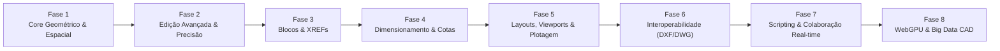

# 🗺️ CloneCAD - Roadmap de Engenharia & Funcionalidades

Roadmap estratégico de arquitetura e funcionalidades para evolução do **CloneCAD** até o padrão industrial de aplicações CAD completas (AutoCAD / BricsCAD / DraftSight no navegador).

---

## 📌 Fase 1: Robustez do Motor Geométrico & Indexação Espacial
> **Objetivo:** Garantir precisão numérica milimétrica e capacidade de consultar dezenas de milhares de entidades a 60 FPS.

- [ ] **Estruturas de Indexação Espacial (R-Tree / BVH):**
  - Implementar um *R-Tree 2D* em memória para particionamento espacial.
  - Otimizar busca por janela (Bounding Box), picking e snapping de $O(N)$ para $O(\log N)$.
- [ ] **Primitivas Geométricas Avançadas:**
  - **Splines (NURBS / B-Splines):** Curvas suaves com nós e pontos de controle editáveis via grips.
  - **Elipses e Arcos Elípticos:** Eixo maior, eixo menor e ângulo de rotação.
  - **Polilinhas com Arcos (Bulge Factor):** Suporte nativo a segmentos curvos dentro da mesma polilinha (padrão DXF).
  - **Hachuras (Hatch / Gradient):** Preenchimento paramétrico de áreas fechadas (ANSI31, sólido, padrões industriais) usando triangulação e Shaders.
- [ ] **Biblioteca de Geometria Computacional:**
  - Integração de biblioteca de clipping robusto (como *Clipper2* compilado via WebAssembly) para união, subtração, interseção e offsets de polígonos com coordenadas inteiras de 64 bits (eliminando instabilidades de ponto flutuante).

---

## 📌 Fase 2: Ferramentas Avançadas de Modificação & Precisão
> **Objetivo:** Equipar o desenhista técnico com as ferramentas essenciais de edição do fluxo diário de CAD.

- [ ] **Ferramentas de Transformação Essenciais:**
  - **TRIM (Aparar) & EXTEND (Estender):** Cálculo automático de limites de corte entre interseções de qualquer primitiva.
  - **OFFSET (Paralelas):** Criação de curvas paralelas equidistantes em linhas, arcos e polilinhas fechadas/abertas.
  - **FILLET (Concordância) & CHAMFER (Chanfro):** Arredondamento com raio pré-determinado ou corte em bisel entre dois segmentos.
  - **MIRROR (Espelhar):** Espelhamento simétrico com opção de manter ou excluir os objetos originais.
  - **STRETCH (Esticar):** Modificação de vértices contidos dentro de uma janela *Crossing Selection*, mantendo as conexões adjacentes.
  - **ARRAY (Matriz):** Criação de padrões repetitivos retangulares, polares (em torno de um centro) e ao longo de um caminho (*Path Array*).
- [ ] **Auxiliares de Precisão Avançados:**
  - **O-Track (Object Snap Tracking):** Linhas guias pontilhadas temporárias alinhadas a pontos de snap existentes (projeção ortogonal de endpoints/centers no cursor).
  - **Polar Tracking:** Travamento angular em incrementos customizáveis (ex: $15^\circ, 30^\circ, 45^\circ, 90^\circ$).

---

## 📌 Fase 3: Sistema de Blocos, Atributos & Biblioteca de Símbolos
> **Objetivo:** Permitir reutilização de componentes padronizados e modularidade de projetos.

- [ ] **Definição e Inserção de Blocos (`BLOCK` / `INSERT`):**
  - Armazenamento de definições de bloco no Core como subcenas instanciáveis.
  - Inserção com ponto base, escala ($X, Y$), ângulo de rotação e camada de destino.
- [ ] **Grips de Edição Rápida:**
  - Manipulação interativa de entidades ao clicar em seus vértices/pontos-chave sem precisar chamar comandos de edição explícitos.
- [ ] **Atributos de Bloco (`ATTDEF`):**
  - Campos de texto variáveis vinculados ao bloco (ex: carimbo de folhas, numeração de portas/janelas, identificadores de circuito elétrico).
- [ ] **Design Center / Biblioteca de Blocos:**
  - Painel lateral com componentes categorizados para Engenharia Civil, Arquitetura, Elétrica e Mecânica com drag-and-drop direto na viewport.
- [ ] **Explosão de Entidades (`EXPLODE`):**
  - Decomposição de blocos, polilinhas e retângulos em suas primitivas básicas constituintes.

---

## 📌 Fase 4: Dimensionamento, Anotações Técnicas & Normas (ABNT / ISO)
> **Objetivo:** Geração de documentação técnica pronta para fabricação e construção.

- [ ] **Tipos de Cotas (Dimension Tools):**
  - **Linear & Alinhada:** Medição horizontal, vertical e paralela ao objeto.
  - **Angular:** Ângulo entre duas linhas concorrentes.
  - **Radial & Diametral:** Marcação de raio e diâmetro com símbolo $\varnothing$ e linha de chamada.
  - **Comprimento de Arco & Coordenadas Ordenadas:** Medições técnicas específicas.
- [ ] **Gerenciador de Estilos de Cota (`DIMSTYLE`):**
  - Configuração de pontas de seta (seta fechada, traço arquitetônico, ponto).
  - Supressão de linhas de cota/extensão, altura do texto e unidades primárias (mm, cm, m, polegadas fracionárias).
  - Tolerâncias dimensionais e limites superior/inferior.
- [ ] **Multileaders (Linhas de Chamada Múltiplas):**
  - Apontadores com texto explicativo ou balões numerados para detalhamento de peças.
- [ ] **Extração de Dados (`DATAEXTRACTION`):**
  - Exportação de quantitativos (comprimentos de tubos, áreas de cômodos, contagem de blocos) para arquivos `.CSV` e `.JSON`.

---

## 📌 Fase 5: Layouts, Viewports, Escalas & Plotagem (Folhas de Impressão)
> **Objetivo:** Separar o ambiente de modelagem (Model Space) do ambiente de pranchas técnicas (Paper Space).

- [ ] **Paper Space (Abas de Layout):**
  - Definição de formatos de folha normalizados (A0, A1, A2, A3, A4 com margens e carimbo).
- [ ] **Viewports Flutuantes (`MVIEW`):**
  - Janelas no papel que enquadram o Model Space em escalas técnicas padronizadas (1:1, 1:50, 1:100, 1:25).
  - Controle de visibilidade de camadas independente por Viewport (*VP Freeze*).
- [ ] **Gerenciador de Estilos de Plotagem (CTB / STB):**
  - Mapeamento de cor da entidade para espessura de traço e cor final na impressão (ex: todas as cores saem em preto monocromático, com espessuras de pena de 0.1mm a 0.8mm).
- [ ] **Módulo de Exportação Vetorial:**
  - Exportação direta para **PDF Vetorial multipágina** de alta fidelidade e resolução independente.

---

## 📌 Fase 6: Interoperabilidade & Suporte a Formatos CAD (.DXF / .DWG)
> **Objetivo:** Permitir abrir e salvar arquivos gerados pelo AutoCAD e outros softwares de mercado.

- [ ] **DXF Parser & Serializer Completo (ASCII & Binário):**
  - Suporte completo às seções `HEADER`, `TABLES` (Layers, Linetypes, TextStyles), `BLOCKS` e `ENTITIES`.
  - Exportação com fidelidade estrita compatível com AutoCAD Release 12 até 2018+.
- [ ] **Leitura de Arquivos DWG Nativos:**
  - Compilação da biblioteca de código aberto *LibreDWG* em **WebAssembly (WASM)**.
  - Conversão in-browser do arquivo binário `.dwg` para a árvore de entidades do Core sem necessidade de upload para servidor externo.
- [ ] **Importação de Imagens Raster Georreferenciadas:**
  - Suporte para inserir plantas escaneadas (PNG, JPG, TIFF) com ferramentas de calibração de escala (dois pontos de referência).

---

## 📌 Fase 7: Extensibilidade, APIs de Scripting & Colaboração em Nuvem
> **Objetivo:** Habilitar automação de tarefas e edição simultânea multiusuário.

- [ ] **Engine de Scripting (TypeScript / AutoLISP):**
  - Console e editor para execução de rotinas automatizadas (ex: gerar eixos de pilares automaticamente, renomear 100 camadas em lote).
  - API pública documentada para desenvolvedores criarem e compartilharem plugins de terceiros.
- [ ] **Colaboração em Tempo Real (Multiplayer CAD):**
  - Implementação de **CRDTs (Conflict-free Replicated Data Types)** via *Yjs* sobre WebSockets/WebRTC.
  - Visualização de cursores remotos com cores individuais e sincronização de comandos sem locks de cena.
- [ ] **Controle de Versão de Desenhos (Git para CAD):**
  - Sistema de branches e histórico visual de commits com *Diff Visual* (realce em vermelho/verde do que foi adicionado/removido entre duas versões).

---

## 📌 Fase 8: Aceleração Gráfica de Última Geração (WebGPU & Big Data)
> **Objetivo:** Suportar projetos com mais de 1.000.000 de entidades vetoriais sem perda de fluidez.

- [ ] **Migração de Renderizador Three.js WebGL para WebGPU:**
  - Uso de *Compute Shaders* para cálculo de interseções geométricas em lote diretamente na GPU.
  - *Instanced Rendering* para símbolos, textos e linhas com atributos de espessura dinâmicos.
- [ ] **Offscreen Canvas & Web Workers:**
  - Isolamento de todo o motor geométrico (cálculos matemáticos, parsing de DXF e indexação espacial) em Web Workers, mantendo a thread de UI do React livre de qualquer engasgo (0ms de input lag).
- [ ] **Level of Detail (LOD) & Frustum Culling Dinâmico:**
  - Descarte instantâneo de geometrias fora do campo de visão da câmera e simplificação visual de detalhes imperceptíveis em níveis altos de zoom out.

---

### 📊 Matriz de Esforço e Priorização

| Fase | Foco Principal | Complexidade Técnica | Impacto no Usuário |
|---|---|:---:|:---:|
| **Fase 1** | Motor Geométrico & R-Tree | 🔴 Alta | 🚀 Crítico (Performance) |
| **Fase 2** | Trim/Extend/Offset/Fillet | 🟡 Média-Alta | ⭐ Máximo (Usabilidade) |
| **Fase 3** | Blocos & Biblioteca | 🟡 Média | ⭐ Alto (Produtividade) |
| **Fase 4** | Cotas & Dimensionamento | 🟡 Média | ⭐ Máximo (Documentação) |
| **Fase 5** | Paper Space & Plotagem PDF | 🟡 Média-Alta | ⭐ Alto (Entregáveis) |
| **Fase 6** | Interoperabilidade DXF/DWG | 🔴 Alta (WASM) | 🚀 Crítico (Adoção) |
| **Fase 7** | Scripting & Colaboração | 🔴 Alta | 💡 Diferencial Competitivo |
| **Fase 8** | WebGPU & Web Workers | 🔴 Alta | 🚀 Escala Industrial |
