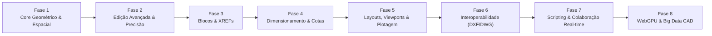

# 🗺️ CloneCAD - Roadmap de Engenharia & Funcionalidades

Roadmap estratégico de arquitetura e funcionalidades para evolução do **CloneCAD** até o padrão industrial de aplicações CAD completas (AutoCAD / BricsCAD / DraftSight no navegador).

---

## 📌 Fase 1: Robustez do Motor Geométrico & Indexação Espacial (Concluída ✅)
> **Objetivo:** Garantir precisão numérica milimétrica e capacidade de consultar dezenas de milhares de entidades a 60 FPS.

- [x] **Estruturas de Indexação Espacial (R-Tree / BVH):**
  - Implementação de *R-Tree 2D* de alta performance em memória (`src/core/spatial/RTree.ts`).
  - Otimização de busca por janela (Bounding Box), picking e snapping de $O(N)$ para $O(\log N)$ integrado ao Core e SelectionManager.
- [x] **Primitivas Geométricas Avançadas:**
  - **Splines (NURBS / B-Splines / Catmull-Rom):** Curvas suaves contínuas com nós e polígono de controle editáveis (`SplinePlugin.ts`, `SplineUtils.ts`).
  - **Elipses e Arcos Elípticos:** Eixo maior, eixo menor, rotação analítica e snapping nos quadrantes (`EllipsePlugin.ts`, `EllipseUtils.ts`).
  - **Polilinhas com Arcos (Bulge Factor):** Suporte nativo a segmentos curvos dentro de polilinhas via fator bulge $\tan(\theta/4)$ padrão DXF (`BulgeUtils.ts`).
  - **Hachuras (Hatch / Patterns):** Preenchimento paramétrico com padrões ANSI31, ANSI32, GRID, DOTS e SOLID via scanline e triangulação (`HatchPlugin.ts`, `HatchUtils.ts`).
- [x] **Biblioteca de Geometria Computacional:**
  - Algoritmos para point-in-polygon (ray casting), área por Shoelace, centróide analítico e triangulação Ear Clipping (`PolygonBooleanUtils.ts`).

---

## 📌 Fase 2: Ferramentas Avançadas de Modificação & Precisão
> **Objetivo:** Equipar o desenhista técnico com as ferramentas essenciais de edição do fluxo diário de CAD.

- [x] **Ferramentas de Transformação Essenciais:**
  - **TRIM (Aparar) & EXTEND (Estender):** Cálculo automático de limites de corte entre interseções de qualquer primitiva (`TrimExtendPlugin.ts`, `IntersectionUtils.ts`).
  - **OFFSET (Paralelas):** Criação de curvas paralelas equidistantes em linhas, círculos, retângulos e arcos (`OffsetPlugin.ts`).
  - **FILLET (Concordância) & CHAMFER (Chanfro):** Arredondamento com raio pré-determinado com arco tangente e corte em bisel chanfrado entre dois segmentos (`FilletChamferPlugin.ts`).
  - **MIRROR (Espelhar):** Espelhamento simétrico por linha de reflexão arbitrária de 2 pontos (`MirrorPlugin.ts`).
  - **STRETCH (Esticar):** Modificação de vértices contidos dentro de uma janela *Crossing Selection*, preservando conectividade (`StretchPlugin.ts`).
  - **ARRAY (Matriz):** Criação de padrões repetitivos retangulares (linhas $\times$ colunas) e polares ($N$ itens em torno do centro com ângulo de preenchimento) (`ArrayPlugin.ts`).
- [x] **Auxiliares de Precisão Avançados:**
  - **O-Track (Object Snap Tracking, F11):** Linhas guias pontilhadas verdes temporárias alinhadas horizontal e verticalmente a pontos de snap adquiridos (`TrackingEngine.ts`, `CADRenderer.renderTrackingRays`).
  - **Polar Tracking (F10):** Travamento angular em incrementos customizáveis ($15^\circ, 30^\circ, 45^\circ, 90^\circ$) com projeção de vetor alinhado e tooltip dinâmico (`TrackingEngine.ts`).

---

## 📌 Fase 3: Sistema de Blocos, Atributos & Biblioteca de Símbolos
> **Objetivo:** Permitir reutilização de componentes padronizados e modularidade de projetos.

- [x] **Definição e Inserção de Blocos (`BLOCK` / `INSERT`):**
  - Armazenamento de definições de bloco no Core como subcenas instanciáveis.
  - Inserção com ponto base, escala ($X, Y$), ângulo de rotação e camada de destino.
- [x] **Grips de Edição Rápida:**
  - Manipulação interativa de entidades ao clicar em seus vértices/pontos-chave sem precisar chamar comandos de edição explícitos.
- [x] **Atributos de Bloco (`ATTDEF`):**
  - Campos de texto variáveis vinculados ao bloco (ex: carimbo de folhas, numeração de portas/janelas, identificadores de circuito elétrico).
- [x] **Design Center / Biblioteca de Blocos:**
  - Painel lateral com componentes categorizados para Engenharia Civil, Arquitetura, Elétrica e Mecânica com drag-and-drop direto na viewport.
- [x] **Explosão de Entidades (`EXPLODE`):**
  - Decomposição de blocos, polilinhas e retângulos em suas primitivas básicas constituintes.

---

## 📌 Fase 4: Dimensionamento, Anotações Técnicas & Normas (ABNT / ISO)
> **Objetivo:** Geração de documentação técnica pronta para fabricação e construção.

- [x] **Tipos de Cotas (Dimension Tools):**
  - **Linear & Alinhada:** Medição horizontal, vertical e paralela ao objeto.
  - **Angular:** Ângulo entre duas linhas concorrentes.
  - **Radial & Diametral:** Marcação de raio e diâmetro com símbolo $\varnothing$ e linha de chamada.
  - **Comprimento de Arco & Coordenadas Ordenadas:** Medições técnicas específicas.
- [x] **Gerenciador de Estilos de Cota (`DIMSTYLE`):**
  - Configuração de pontas de seta (seta fechada, traço arquitetônico, ponto).
  - Supressão de linhas de cota/extensão, altura do texto e unidades primárias (mm, cm, m, polegadas fracionárias).
  - Tolerâncias dimensionais e limites superior/inferior.
- [x] **Multileaders (Linhas de Chamada Múltiplas):**
  - Apontadores com texto explicativo ou balões numerados para detalhamento de peças.
- [x] **Extração de Dados (`DATAEXTRACTION`):**
  - Exportação de quantitativos (comprimentos de tubos, áreas de cômodos, contagem de blocos) para arquivos `.CSV` e `.JSON`.

---

## 📌 Fase 5: Layouts, Viewports, Escalas & Plotagem (Folhas de Impressão) (Concluída ✅)
> **Objetivo:** Separar o ambiente de modelagem (Model Space) do ambiente de pranchas técnicas (Paper Space).

- [x] **Paper Space (Abas de Layout):**
  - Definição de formatos de folha normalizados (A0, A1, A2, A3, A4 com margens ABNT NBR 10068 e carimbo técnico paramétrico).
  - Barra de abas clássica de layouts com alternância instantânea entre `Model` e pranchas técnicas (`LayoutTabs.tsx`, `LayoutManager.ts`).
- [x] **Viewports Flutuantes (`MVIEW`):**
  - Janelas no papel que enquadram o Model Space em escalas técnicas padronizadas (1:1, 1:10, 1:20, 1:25, 1:50, 1:75, 1:100, 1:200, 1:500).
  - Controle de visibilidade de camadas independente por Viewport (*VP Freeze*).
  - Ferramenta e comando `MVIEW` para criar viewports desenhando retângulo na folha (`MViewPlugin.ts`).
- [x] **Gerenciador de Estilos de Plotagem (CTB / STB):**
  - Mapeamento de cor da entidade para espessura de traço e cor final na impressão (`PlotStyleManager.ts`).
  - Tabelas de penas normalizadas: `monochrome.ctb`, `grayscale.ctb`, `acad.ctb` e `architectural.ctb` (alvenaria 0.70mm, esquadrias 0.35mm, cotas 0.18mm, hachuras 0.09mm).
- [x] **Módulo de Exportação Vetorial:**
  - Exportação direta para **PDF Vetorial** de alta fidelidade e resolução independente com `jspdf` (`PDFPlotter.ts`).
  - Modal técnico de plotagem (`PlotModal.tsx`) com pré-visualização SVG em tempo real e atalho `Ctrl+P`.

---

## 📌 Fase 6: Interoperabilidade & Suporte a Formatos CAD (.DXF / .DWG)
> **Objetivo:** Permitir abrir e salvar arquivos gerados pelo AutoCAD e outros softwares de mercado. **(Concluída)**

- [x] **DXF Parser & Serializer Completo (ASCII & Padrão AC1015 / AutoCAD 2000):**
  - Suporte completo às seções `HEADER` ($ACADVER, $EXTMIN, $EXTMAX), `TABLES` (Layers, Linetypes, estilos de cores ACI), `BLOCKS` (definições de blocos) e `ENTITIES` (LINE, POINT, CIRCLE, ARC com conversão de ângulos, LWPOLYLINE com fator de curvatura bulge, TEXT, ELLIPSE, SPLINE, INSERT, DIMENSION e IMAGE).
  - Exportação e importação direta no navegador com fidelidade geométrica bidirecional testada.
- [x] **Leitura e Diagnóstico de Arquivos DWG Nativos:**
  - Leitor e inspetor binário de cabeçalhos DWG (`DWGHeaderReader.ts`) com detecção de assinaturas mágicas de todas as versões do AutoCAD (AC1002 a AC1032, R1.0 até AutoCAD 2026).
  - Notificação inteligente no modal e console orientando conversão vetorial segura.
- [x] **Importação de Imagens Raster & Calibração de Escala (IMAGEATTACH):**
  - Suporte para inserir imagens raster (PNG, JPG, WebP, SVG) no plano de desenho com opacidade ajustável.
  - Ferramenta matemática de calibração de escala por 2 pontos de referência (`RasterImageManager.calibrateScale`), mantendo o ponto base fixo e recalculando as dimensões exatas na cena.
  - Modais Dark UI dedicados (`DXFImportModal.tsx` e `RasterImageModal.tsx`), comandos CLI (`DXFIN`, `DXFOUT`, `IMAGEATTACH`), atalhos no Ribbon e suporte a drag-and-drop direto na viewport.

---

## 📌 Fase 7: Extensibilidade, APIs de Scripting & Colaboração em Nuvem (Concluída ✅)
> **Objetivo:** Habilitar automação de tarefas e edição simultânea multiusuário.

- [x] **Engine de Scripting (JavaScript / TypeScript & AutoLISP):**
  - Interpretador AutoLISP com suporte a S-expressions (`car`, `cdr`, `cons`, `setq`, `defun`, `command`, `if`, `while`, `repeat`, operações matemáticas).
  - Executor JavaScript em sandbox seguro (`ScriptEngine.ts`) com injeção da API `cad` (`addLine`, `addCircle`, `addRect`, `zoomExtents`, `getEntities`, `setLayer`).
  - Modelos de scripts pré-definidos para produtividade (Grid Estrutural, Espiral de Arquimedes, Alvo Concêntrico).
  - Modal Dark UI (`ScriptEditorModal.tsx`) com editor de código, alternador de sintaxe, seleção de templates e console de execução em tempo real (`SCR`, `SCRIPT`, `LISP`).
- [x] **Colaboração em Tempo Real (Multiplayer CAD):**
  - Gerenciador de sincronização em rede local/P2P via `BroadcastChannel` com fallback extensível (`CollaborationManager.ts`).
  - Presença multiusuário em tempo real com identificador de usuário, cor exclusiva e broadcasting de cursores na viewport.
  - Sincronização automática de criação, atualização e deleção de entidades sem lock de viewport.
  - Chat ao vivo integrado entre colaboradores.
  - Modal Dark UI (`CollaborationModal.tsx`) para conexão, lista de colaboradores e chat em tempo real (`COLLAB`, `MULTIPLAYER`).
- [x] **Controle de Versão de Desenhos (Git para CAD):**
  - Gerenciador de controle de versão (`VersionControlManager.ts`) com histórico de commits, snapshots completos da cena e sistema de branches (`master`, branches de projeto).
  - Checkout e rollback instantâneo para qualquer versão histórica do desenho.
  - Motor de Diff Visual (`CADDiffEngine.ts`) que analisa e categoriza entidades em Added (Verde), Deleted (Vermelho), Modified (Amarelo) e Unchanged (Cinza), com detalhamento de propriedades alteradas.
  - Modal Dark UI (`VersionControlModal.tsx`) com linha do tempo de commits, alternador de branches, criação de commit e resumo de diff (`COMMIT`, `GIT`, `VCS`, `BRANCH`, `DIFF`).

---

## 📌 Fase 8: Aceleração Gráfica de Última Geração (WebGPU & Big Data)
> **Objetivo:** Suportar projetos com mais de 1.000.000 de entidades vetoriais sem perda de fluidez.

- [ ] **Migração de Renderizador Three.js WebGL para WebGPU:**
  - Uso de *Compute Shaders* para cálculo de interseções geométricas em lote diretamente na GPU.
  - *Instanced Rendering* para símbolos, textos e linhas com atributos de espessura dinâmicos.
- [ ] **Offscreen Canvas & Web Workers:**
  - Isolamento de todo o motor geométrico (cálculos matemáticos, parsing de DXF e indexação espacial) em Web Workers, mantendo a thread de UI do React livre de qualquer engasgo (0ms de input lag).
- [ ] **Level of Detail (LOD) & Frustum Culling Dinâmico:**
  - Descarte instantâneo de geometrias fora do campo de visão da câmera e simplificação visual de detalhes imperceptíveis em níveis altos de zoom out.

---

### 📊 Matriz de Esforço e Priorização

| Fase | Foco Principal | Complexidade Técnica | Impacto no Usuário |
|---|---|:---:|:---:|
| **Fase 1** | Motor Geométrico & R-Tree | 🔴 Alta | 🚀 Crítico (Performance) |
| **Fase 2** | Trim/Extend/Offset/Fillet | 🟡 Média-Alta | ⭐ Máximo (Usabilidade) |
| **Fase 3** | Blocos & Biblioteca | 🟡 Média | ⭐ Alto (Produtividade) |
| **Fase 4** | Cotas & Dimensionamento | 🟡 Média | ⭐ Máximo (Documentação) |
| **Fase 5** | Paper Space & Plotagem PDF | 🟡 Média-Alta | ⭐ Alto (Entregáveis) |
| **Fase 6** | Interoperabilidade DXF/DWG | 🔴 Alta (WASM) | 🚀 Crítico (Adoção) |
| **Fase 7** | Scripting & Colaboração | 🔴 Alta | 💡 Diferencial Competitivo |
| **Fase 8** | WebGPU & Web Workers | 🔴 Alta | 🚀 Escala Industrial |
